Nuxt DevTools registers a `Nuxt` group in the [Vite DevTools](https://github.com/vitejs/devtools) panel. Its tabs are sorted into sections: **App**, **Analyze**, **Server**, **Modules** and **Advanced**. Some tabs only appear when they have something to show, for example Server Tasks when your project defines tasks.

Next to the `Nuxt` group, the panel also holds docks shared with every Vite tool: [Vue DevTools](#vue-devtools), [Inspect](#inspect), [Terminals](#terminals) and [Messages](#messages).

## App

### Overview

Shows a quick overview of your app: the Nuxt and Vue versions (with a hint when an update is available), how many pages, components, imports, modules and plugins you use, and how long your app took to load.

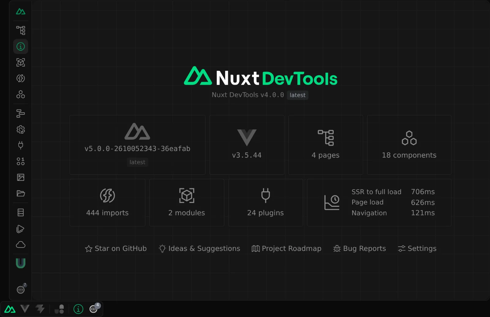

### Pages

Shows your current routes with their layout and middleware, and provides a quick way to navigate between pages. Edit the current path to see how each route is matched.

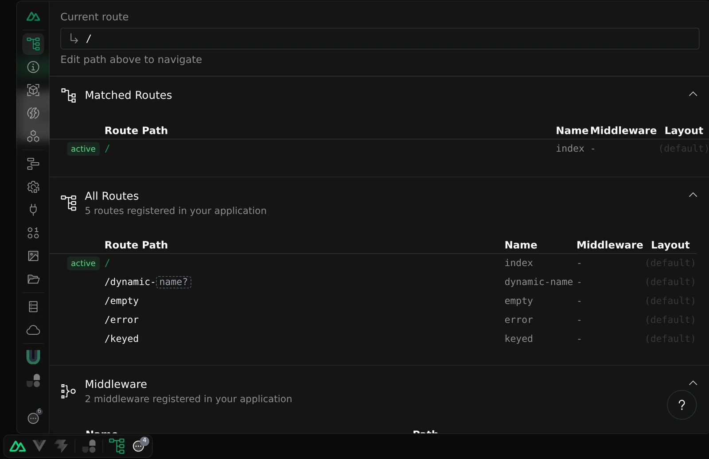

### Components

Shows all the components in your app and where they come from. Search for them and jump to their source code.

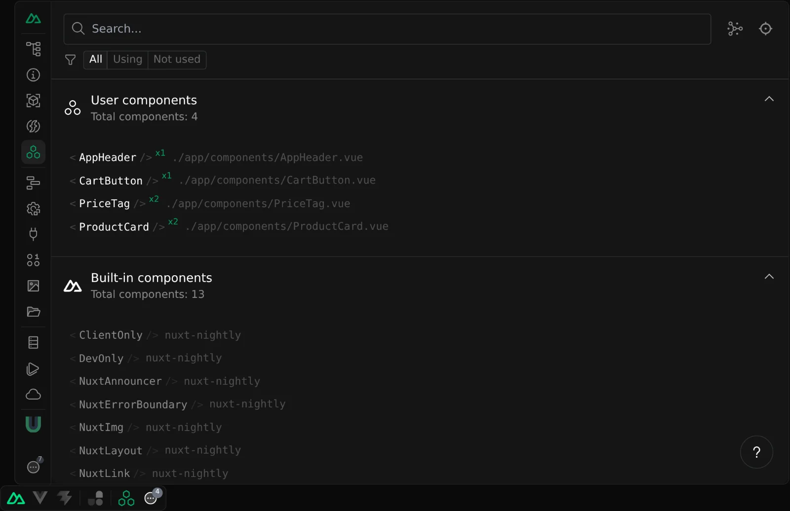

The Graph view shows the relationships between components and the dependencies of each one. Its dependency edges need the optional [`vite-plugin-inspect`](#inspect) installed.

You can also inspect your app's DOM tree to find which component renders it. Turn the inspector off with `devtools.componentInspector: false`.

### Imports

Shows all the auto-imports registered to Nuxt, which files use them, and where they come from. Some entries provide short descriptions and documentation links.

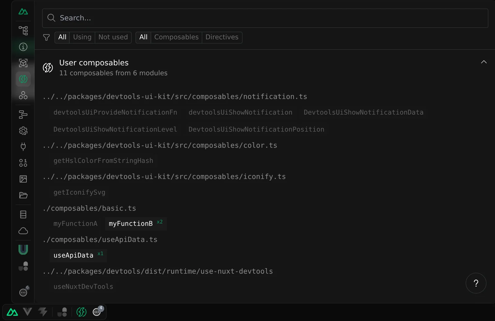

### Modules

Shows the modules you have installed with their repository, documentation, version and setup time. You can install or remove any Nuxt module from the [module registry](/modules) with one click.

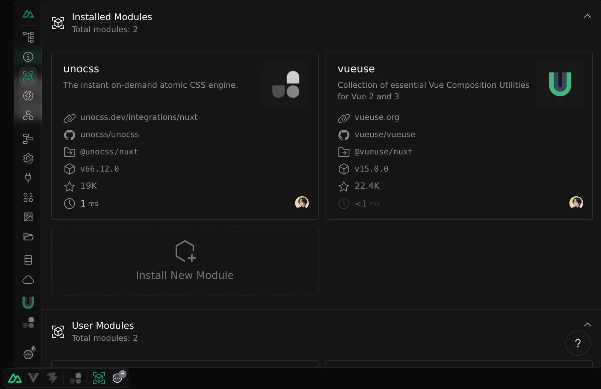

### Error

Appears while the current page holds an error, and shows it with its stack trace.

## Analyze

### Payload

Shows the state and data payloads of your page: keyed state from `useState()` and the data fetched with `useAsyncData()` and `useFetch()`, which you can re-fetch.

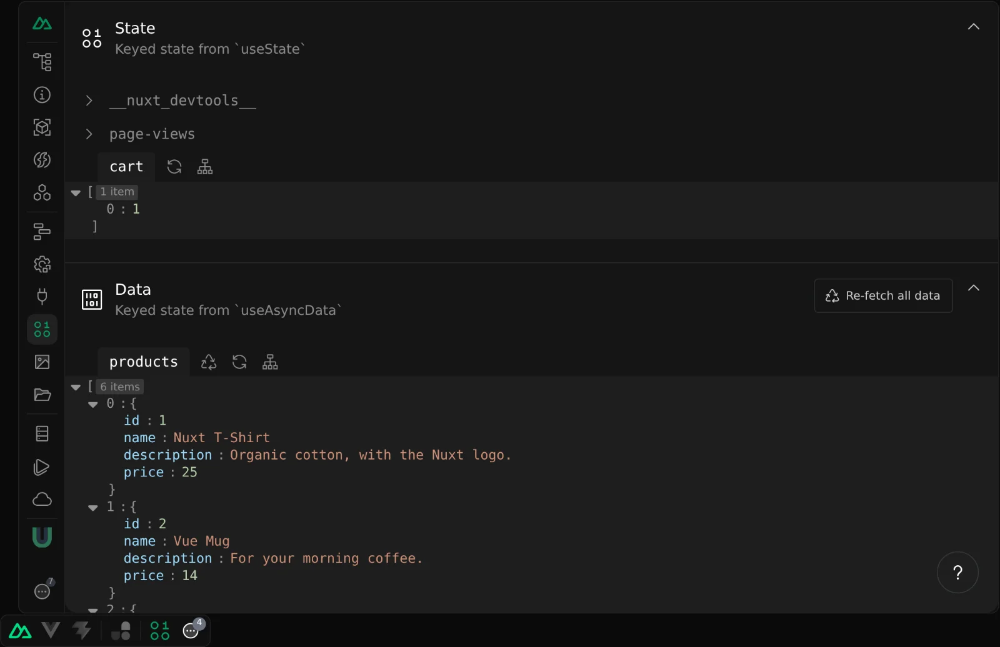

### Runtime Configs

Shows your App Config and runtime config. App Config and public runtime config can be edited live; private runtime config is read-only, as it is never exposed to the client.

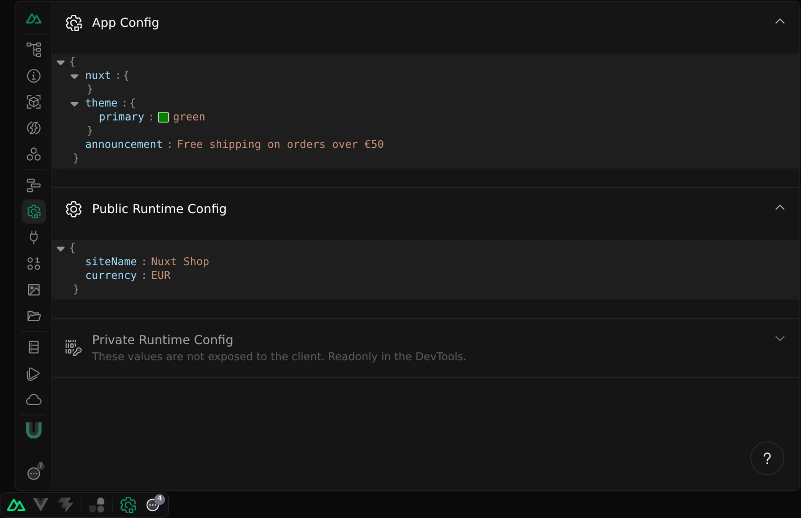

### Plugins

Shows the plugins of your app, with their mode (client or server) and initialization time.

### Timeline

Records when auto-imported composables run and when the route changes, to help you understand the order in which things happen. It is opt-in: until it is enabled, the tab offers to enable it for you, which updates your `nuxt.config` and restarts Nuxt.

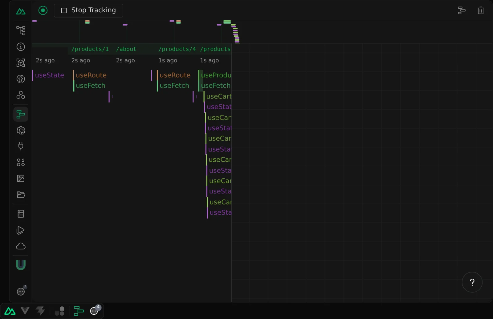

```ts [nuxt.config.ts]
export default defineNuxtConfig({
  devtools: {
    timeline: {
      enabled: true,
    },
  },
})
```

By default it tracks the composables from `#app`, `@unhead/vue` and your `composables/` directory. Use `timeline.functions.include`, `includeFrom` and `exclude` to change what is tracked.

### Build Analyze

Runs an analyze build and shows the bundle size of your project. Reports are saved so you can compare the bundle size of different builds. The build output streams to the [Terminals](#terminals) dock.

### Assets

The Assets panel, powered by [`@devframes/plugin-assets`](https://npmx.dev/package/@devframes/plugin-assets), lists the files of your `public/` directory. Preview, upload, rename and delete them from the panel. Limit which files can be uploaded with `devtools.assets.uploadExtensions`, or set it to `'*'` to accept any.

### Open Graph

The Open Graph panel, powered by [`@devframes/plugin-og`](https://npmx.dev/package/@devframes/plugin-og), fetches a page from your dev server, shows its Open Graph and Twitter metadata, and previews its social card on X (Twitter), Facebook, LinkedIn and Telegram.

## Server

### Server Routes

Shows all the [Nitro](https://nitro.build) routes of your project, with a playground to send requests to your endpoints and inspect their responses.

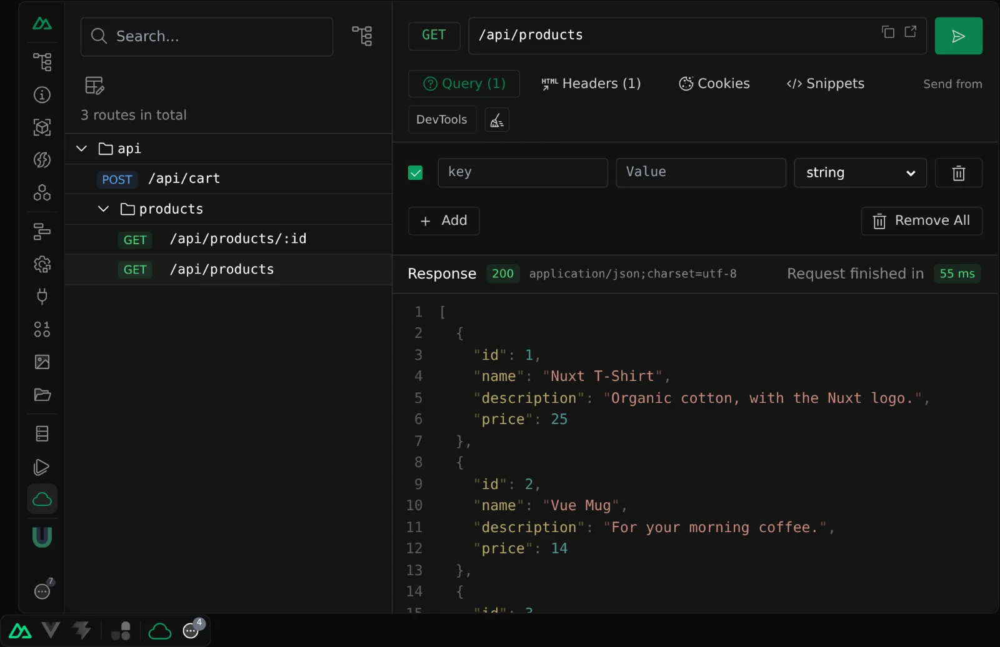

### Server Tasks

Appears when Nitro's `experimental.tasks` is enabled and your project defines [tasks](https://nitro.build/guide/tasks). Pass task payloads, run them, and see their results.

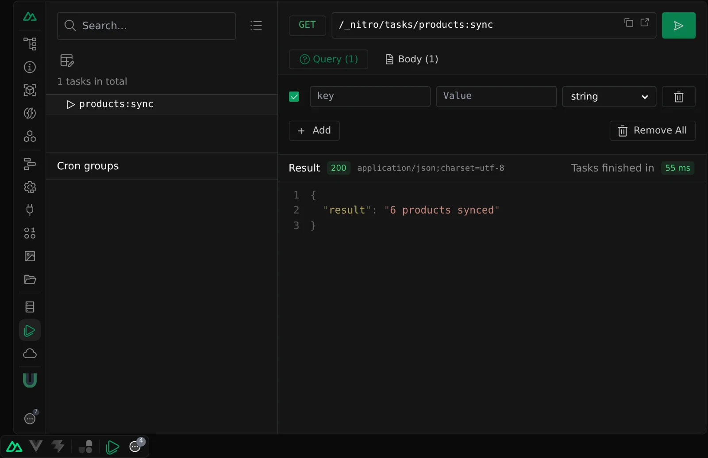

### Storage

Shows the [Nitro storage](https://nitro.build/guide/storage) mounts of your project. You can create, edit, and delete their items.

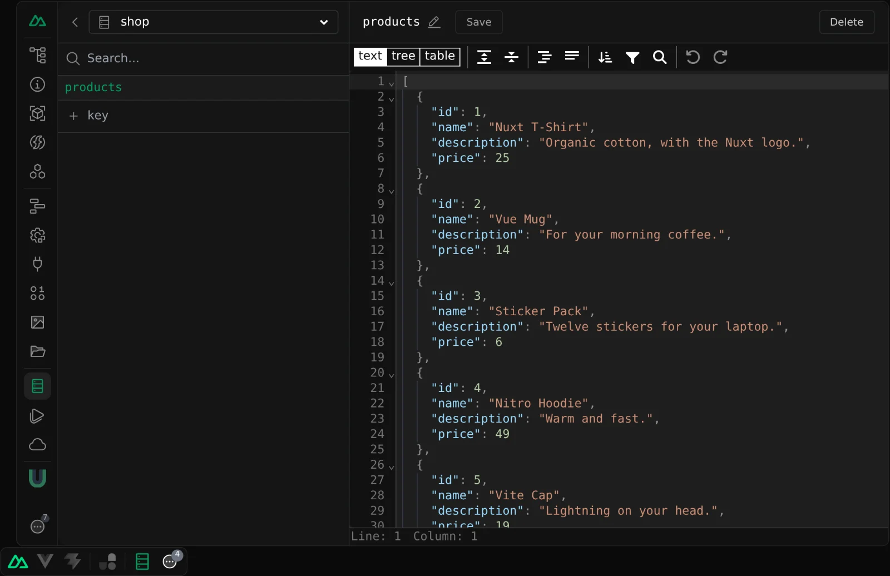

## Modules

Tabs contributed by the Nuxt modules you install (for example `@nuxt/fonts`, `@nuxt/scripts` or `nuxt-og-image`) appear in this section. See the [Module Authors Guide](/modules/devtools/module-authors) to add your own.

### Code Server

Embeds [Coder's `code-server`](https://coder.com/docs/code-server/install). It is enabled by default: Nuxt DevTools detects the local `code-server` binary during setup, but starts no process until you choose **Launch editor**. If the binary is missing, the tab shows installation instructions instead.

When launched, Code Server opens the Nuxt root directory by default, hands the generated authenticated session to the iframe, and streams process output to the [Terminals](#terminals) dock. The process is also stopped when Nuxt closes.

```ts [nuxt.config.ts]
export default defineNuxtConfig({
  devtools: {
    codeServer: {
      enabled: true,
      // All fields below are optional.
      bin: '/usr/local/bin/code-server',
      cwd: '/workspace/my-app',
      serverPort: 8080,
      host: '127.0.0.1',
      args: ['--disable-file-downloads'],
      env: { LOG_LEVEL: 'info' },
      cookieSuffix: 'my-app',
      startTimeout: 30_000,
    },
  },
})
```

The options are `enabled`, `bin`, `cwd`, `serverPort`, `host`, `args`, `env`, `cookieSuffix`, and `startTimeout`. When omitted, the upstream plugin defaults apply: the `code-server` binary, loopback host, a free port near Code Server's port 8080, and a 30-second startup timeout. Nuxt changes only the default `cwd`, setting it to the Nuxt root. Set `codeServer.enabled: false` to remove the tab.

Nuxt DevTools owns authentication, so `args` cannot override `--auth`, `--bind-addr`, or `--cookie-suffix`, and `env` cannot set `PASSWORD` or `HASHED_PASSWORD`. Configure the bind host and cookie suffix through their dedicated fields.

The editor iframe connects directly to the Code Server port; Nuxt does not proxy it through `app.baseURL`. The browser must be able to reach that host and port, and an HTTPS page cannot embed an HTTP-only editor because of browser mixed-content rules. Binding to a non-loopback interface also exposes the port to that network, so apply the usual network controls.

This integration uses the experimental upstream `@devframes/plugin-code-server`. HTTPS, reverse proxies, containers, and remote port forwarding are governed by that plugin and your environment; Nuxt does not extend them.

## Advanced

### Hooks

Shows the time spent in each Nuxt hook on the client and the server, to help you find performance bottlenecks.

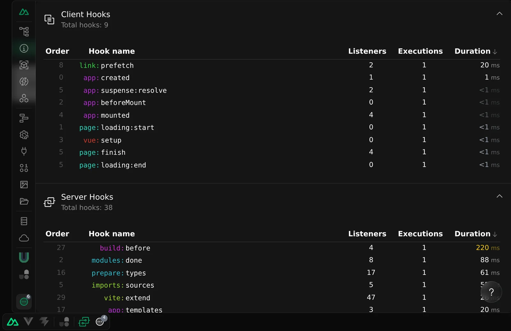

### Virtual Files

Shows the virtual files Nuxt generates to support its conventions.

### Debug

With `debug: true` in your `nuxt.config`, lists which module changed which Nuxt option during setup.

### Data Inspector

An interactive [jora](https://discoveryjs.github.io/jora/) query workbench over your live server-side configuration. It replaces the read-only Nuxt Options Viewer of v3. Turn it off with `devtools.dataInspector: false`.

Its `Nuxt Application` source exposes three root fields:

- `nuxt` — the resolved Nuxt options.
- `nitro` — the resolved Nitro options, once Nitro is created.
- `vite` — the live Vite dev server: its resolved config at `vite.config`, and its `environments` (`client` and `ssr`).

The source is live: every query reads the current state, so re-running a query after the Nitro and Vite hooks have completed reflects the latest values. Six presets are provided: **Overview**, **Nuxt modules**, **Vite plugins**, **Vite config**, **Vite environments** and **Nitro routes**, each leaving functions out so browsing configuration does not foreground methods.

Module authors who want to expose their own data can install [`@devframes/plugin-data-inspector`](https://npmx.dev/package/@devframes/plugin-data-inspector) and register sources through its `registerDataSource` API; they appear in the same inspector without any Nuxt-specific wrapper.

::warning
The `getServerData` DevTools RPC that backed the old viewer is deprecated (`NDT_DEP_0009`). It still works as a compatibility shim but will be removed in v5; use the Data Inspector instead.
::

### Settings

Change the UI scale, toggle the help buttons, choose the editor used by _Open in editor_, opt out of anonymous telemetry, or reset the local DevTools state. Hiding, pinning and reordering tabs is handled by Vite DevTools.

## Vite DevTools Docks

### Vue DevTools

Nuxt installs [Vue DevTools](https://devtools.vuejs.org) (`vite-plugin-vue-devtools`), which registers its own dock next to the `Nuxt` group to inspect your components' state, Pinia stores and more. Turn it off with `devtools.vueDevTools: false`.

### Inspect

Exposes the [`vite-plugin-inspect`](https://github.com/antfu/vite-plugin-inspect) integration as its own dock, to inspect the transformation steps of Vite.

`vite-plugin-inspect` is an optional peer dependency, so it is not installed by default. Until you add it to your project, the Inspect dock shows an install launcher: click it to install the plugin and restart the dev server. Set `devtools.viteInspect: false` to remove the dock and its launcher.

### Terminals

Processes started by DevTools and modules, such as module installs, Build Analyze and Code Server, appear in the shared Terminals dock of Vite DevTools.

### Messages

Notifications from DevTools and modules land in the Messages dock of Vite DevTools as a persistent list, optionally also shown as a toast.
